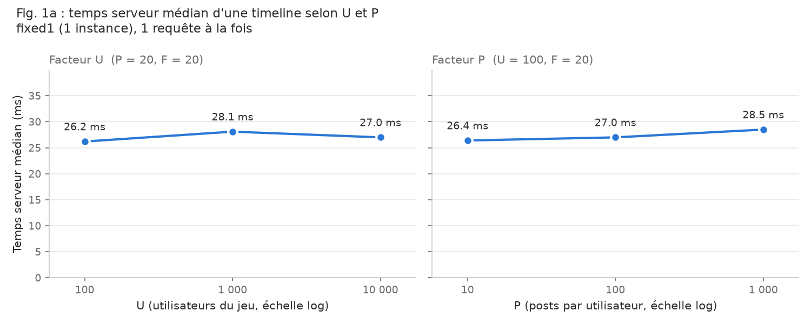
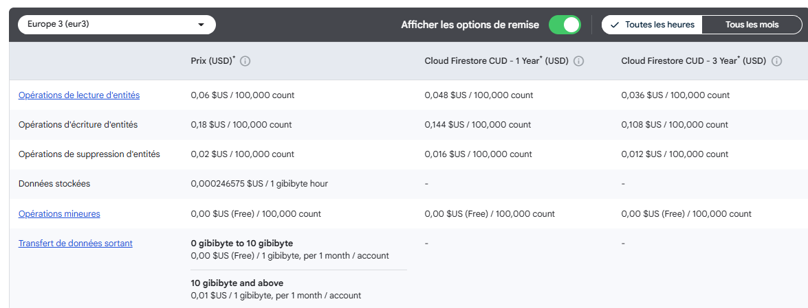
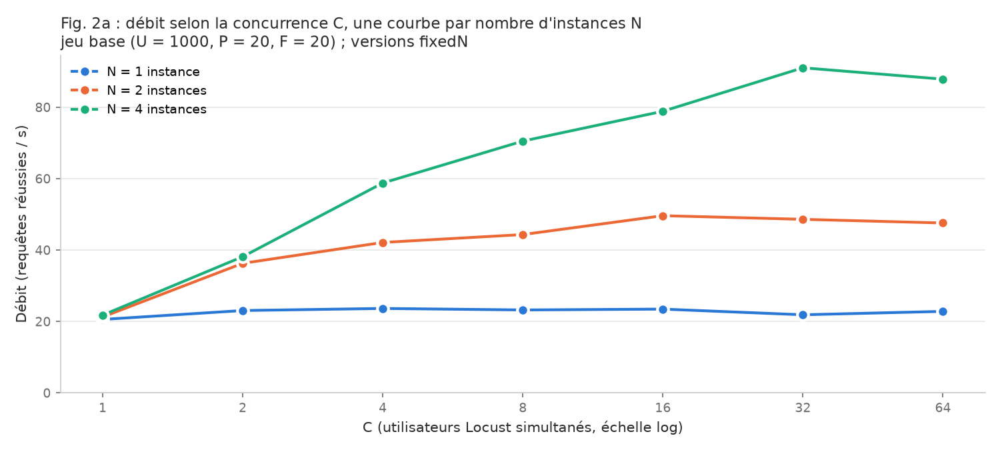
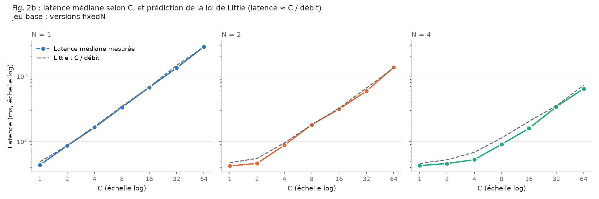
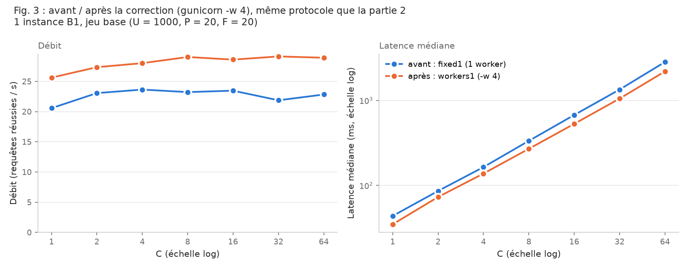

# PROJET-DONNEES-MASSIVES-ET-CLOUD
> TinyInsta passe-t-elle à l’échelle ? — Benchmark, édition 2026

<!--
Sections imposées du README : 
1. Montage (projet, région, versions, dates, d’où tourne le client).
2. Résultats des parties 1 à 3 (pour chacune : hypothèse, figures, interprétation).
3. Tableau des verdicts.
4. Validité.
5. Coût de la campagne.
-->

# Rapport
## 1. Montage
- Projet : tp1bigdata2026
- Région : europe-west1
- Emplacement de la base Datastore : eur3
- Versions :
    - Par défaut une instance en autoscaling nommée 20261121t111034, créée le 21/11 à 12h12m38s (2026-11-21T11:12:38+00:00)  
    > l'URL https://tp1bigdata2026.ew.r.appspot.com <!-- J'ai repris la base du projet TP1 -->
    - Une instance fixe (sans autoscaling) nommée fixed1, créée le 21/11 à 15h39m55s (2026-11-21T14:39:55+00:00)
    > l'URL : https://fixed1-dot-tp1bigdata2026.ew.r.appspot.com
    - Deux instances fixes (sans autoscaling) nommées fixed2, créées le 27/11 à 18h55m16s (2026-11-27T17:55:16+00:00)
    > l'URL : https://fixed2-dot-tp1bigdata2026.ew.r.appspot.com
    - Quatre instances fixes (sans autoscaling) nommées fixed4, créées le 27/11 à 19h13m33s (2026-11-27T18:13:33+00:00)
    > l'URL : https://fixed4-dot-tp1bigdata2026.ew.r.appspot.com
    - Une instance fixe (sans autoscaling) avec 4 workers gunicorn (partie 3) nommée workers1, créée le 27/11 à 22h22m00s (2026-11-27T21:22:00+00:00)
    > l'URL : https://workers1-dot-tp1bigdata2026.ew.r.appspot.com
- Client : Locust 2.47.0, lancé depuis Cloud Shell

## 2. Résultats

<a id="partie-1"></a>
### Partie 1 — Coût d’une requête  

> Question : de quoi dépend le temps de traitement d’une timeline ?

- <ins>Analyse de la fonction `get_timeline` dans le main.py</ins>:
    - La fonction a pour but d'envoyer 20 posts des gens que l'utilisateur suit et les posts de l'utilisateur lui-même dans son fil d'actualité (timeline)
    - Elle est composée de 3 méthodes pour obtenir cette timeline :
        1. Première méthode : Utilise GQL si le SDK python est capable pour obtenir les 20 derniers posts des utilisateurs suivis par date de création, sinon appelle deuxième méthode. À noter qu'après un test effectué plus tard dans le développement, j'ai testé si la bibliothèque "google-cloud-datastore" possédait la méthode "gql" et le résultat est non. 
        Voir requête ci-dessous :
        ```
        session@cloudshell:~ (tp1bigdata2026)$ python3 -c "from google.cloud import datastore; print('gql ?', hasattr(datastore.Client(), 'gql'))" 
        gql ? False
        ```
        2. Deuxième méthode : Possède le même sens que la requête d'avant, mais construite avec des fonctions python. À noter que le paramètre 'IN' ne peut excéder 30 clauses d'égalité (==) sur la même propriété. [Utilisez l'opérateur `IN` pour combiner jusqu'à 30 clauses d'égalité (`==`) sur la même propriété avec un opérateur `OR` logique.](https://docs.cloud.google.com/datastore/docs/concepts/queries?hl=fr#in)
        3. Troisième méthode : Possède aussi le même sens que les requêtes d'avant. Cette méthode effectue manuellement les égalités en faisant une requête pour chacun des gens que l'on suit (peut devenir très coûteux si l'on suit beaucoup de gens).

- <ins>Hypothèse pour chaque attribut</ins> :
    - U : Qu'il y ait 1 ou énormément d'utilisateurs la requête s'effectue juste pour 1 utilisateur, donc le temps de traitement devrait être quasi constant.
    - P : Dû au limit 20 et avec l'index trié par date, on ne lit jamais plus de 20 posts par requête, donc le temps de traitement devrait être quasi constant.
    - F : La liste envoyée au 'IN' contient F+1 valeurs (les F gens suivis + l'utilisateur lui-même).
        - Si F+1 ≤ 30, soit F ≤ 29 : passe par la deuxième méthode donc n'utilise qu'une seule requête, donc temps de traitement quasi constant.
        - Si F+1 > 30, soit F ≥ 30 : la limite de 30 du 'IN' fait échouer la deuxième méthode, et ça bascule sur la troisième, qui fait F+1 requêtes les unes après les autres. Donc le temps de traitement sera sûrement linéaire en F.
        - On s'attend donc à voir un goulot d'étranglement à F = 30.
        

- <ins>Protocole</ins> :
    - Version fixed1 (1 instance fixe), 1 requête à la fois ("-u 1"), 45s par run, une run par jeu de données (26 runs : base, u100, u10000, p10/p100/p1000, f05 à f100). Les runs ont été lancés à la suite depuis Cloud Shell avec [`scripts/mesures_p1.sh`](scripts/mesures_p1.sh), les journaux bruts sont dans [`raw/`](raw/) (`p1_<jeu>.csv`). Les figures et leurs CSV sont générés par [`scripts/figures.py`](scripts/figures.py). Les 5 premières secondes de chaque run sont écartées (cold start) et 0 échec avec des HTTP 200.

---

### <ins>Analyse des figures</ins> :


- On remarque sur cette image que les facteurs U et P ont quelques millisecondes (1-2ms) de différence sur des jeux de données de 1 à 10 à 100 fois plus grands. Cette différence de quelques ms est probablement une marge d'erreur liée au bruit. 

---


- De F = 5 à F = 25 le graphique semble constant puis on remarque sur la figure un point de bascule entre F = 25 et F = 30 suivi d'une montée quasi linéaire.

---

- <ins>Vos hypothèses sont-elles confirmées ? Sinon, qu’aviez-vous manqué</ins> ?
    - U : Oui, l'écart d'environ 1-2ms est lié au bruit mais le temps est bien quasi constant avec le facteur U.
    - P : Oui, pareil pour l'écart d'environ 2ms, c'est lié au bruit. C'est quasi constant avec le facteur P grâce à l'index composite Post(author, created desc), qui trie les posts de chaque auteur par date et avec LIMIT 20 on ne lit jamais plus de 20 posts.
    - F : Oui en partie 
        - Pour F = 30 on a bien eu un goulot d'étranglement (F = 25 à F = 30) dû au "IN" du programme qui ne fonctionne plus après F+1 = 30, c'est passé d'environ 30ms à environ 500ms soit 18 fois plus.
        - De F = 5 à F = 25, on est passé de 23,9ms à 29,3ms : le temps n'est donc pas strictement constant, il y a une légère augmentation que je n'avais pas prévue (Datastore exécute probablement le "IN" comme F+1 sous-requêtes qu'il fusionne). Mais cette hausse de 5ms reste négligeable comparé à l'augmentation à partir de F = 30.
        - Après F = 30 la montée est bien linéaire : le temps passe de 527ms (F = 30) à 1829ms (F = 100), soit environ 19ms de plus par compte suivi. Le F = 75 (1462ms) est plus grand que le F = 80 (1393ms), je ne pense pas que ça invalide l'hypothèse sur la linéarité après F = 30 mais qu'il s'agit de bruit induit par le protocole du 45s par run, l'échantillon possède environ 900 requêtes sur les F faibles et environ 25 pour les F élevés.

- <ins>Quelle part de la latence client est due au réseau</ins> ?
    - L'écart entre la latence client et le temps serveur ne bouge pas beaucoup, environ 13,5ms (entre 12,5ms et 15,8ms) pour tous les jeux de données, ça ne dépend donc pas de U, P ou F.
    - Pour les timelines rapides F ≤ 25, environ 30 à 35% du temps se passe hors de `get_timeline`, ce qui inclut le réseau, tandis que pour les grosses timelines F = 100, ça représente moins d'1% du temps. Le réseau pèse donc beaucoup sur les petites requêtes, mais presque rien sur les grosses.


- <ins>Combien d’entités Datastore une timeline lit-elle, selon U, P et F</ins> ? <ins>Déduisez-en le coût de 1 million de timelines dans chaque cas (grille tarifaire de Datastore)</ins> :
    - Cela dépend uniquement de F, pas de U ni P. On lit toujours 1 entité User (l'user qui consulte sa timeline) et au minimum 20 posts (en partant du principe que chaque auteur a au moins 20 posts), donc au minimum 1+20 = 21 entités.
    - Avec 1 million de timelines par cas, on a :
        - Pour un F ≤ 29 (avant le goulot d'étranglement) : 21*0,60 = 12,60$
        - Une fois le goulot d'étranglement atteint (F ≥ 30) nous pouvons effectuer la formule : 1+20*(F+1) = nombre d'entités
        - F = 30 : (1+20*(30+1))\*0,60 = 621\*0,60 = 372,60$
        - F = 100 : (1+20*(100+1))\*0,60 = 2021\*0,60 = 1212,60$




### Partie 2 — Capacité

> Question : combien de timelines par seconde une instance peut-elle servir ? Le débit maximal est-il proportionnel au nombre d’instances ?

- <ins>Hypothèses formulées</ins> :
    - L'application est lancée avec `gunicorn -b :$PORT main:app` dans `deploy_fixed.sh`. D'après la documentation de gunicorn par défaut le nombre de workers est défini à 1, or il est possible d'augmenter ce nombre via le paramètre -w. [Command line: -w INT, --workers INT.](https://gunicorn.org/reference/settings/#workers)
    - Pour N = 1, le débit devrait donc atteindre son maximum à partir de C = 2 étant donné qu'une seule requête est traitée à la fois.
    - Les requêtes sont empilées dans une queue, je pense que la latence devrait augmenter par rapport à C puisque la loi de Little est `latence = C/débit`. Une fois le débit saturé il ne bouge plus, donc la latence devrait être proportionnelle à C : pour N = 1, par rapport à C = 1, elle devrait doubler à C = 2, quadrupler à C = 4, ..., et être multipliée par 64 à C = 64.
    - Avec N instances le débit maximal sera sûrement multiplié par N si Google Cloud répartit bien la charge. Cela devrait aussi fixer le point de saturation à partir de C = N.
    - Le temps médian d'une requête sur la partie 1 était d'environ 28ms côté serveur. Comme une instance est configurée par défaut pour n'avoir qu'un worker via le code, elle devrait plafonner à 1/0,028 soit environ 35 requêtes par seconde.

- <ins>Protocole</ins> :
    - Versions fixed1, fixed2 et fixed4 (N = 1, 2, 4 instances fixes), jeu de données (base, U = 1000, P = 20, F = 20), C ∈ {1, 2, 4, 8, 16, 32, 64} utilisateurs simultanés ("-u C"), 45s par run, 7 runs par version (21 runs au total). Une seule version déployée à la fois pour limiter le coût, version arrêtée à la fin de ses mesures. Les runs ont été lancés à la suite depuis Cloud Shell avec [`scripts/mesures_p2.sh`](scripts/mesures_p2.sh), utilisation : (`bash scripts/mesures_p2.sh N`), les journaux bruts sont dans [`raw/`](raw/) (`p2_N<N>_C<C>.csv`). Les figures et leurs CSV sont générés par [`scripts/figures.py`](scripts/figures.py). Les 5 premières secondes de chaque run sont écartées (cold start), seules les réponses HTTP 200 sont comptées dans le débit et les médianes, et le nombre d'instances actives est vérifié avec l'en-tête `X-Instance`.

---

### <ins>Analyse des figures</ins> :


- Pour N = 1, le débit plafonne à environ 23 requêtes par seconde, dès que C = 2 ça ne bouge plus jusqu'à C = 64. Pour N = 2, il monte jusqu'à environ 49 requêtes par seconde vers C = 16. Pour N = 4 jusqu'à environ 91 requêtes par seconde vers C = 32. Plus il y a d'instances, plus le plafond est haut, mais il faut de plus en plus d'utilisateurs simultanés pour l'atteindre.

---


- Une fois le débit saturé, la latence double à chaque fois que C double (droite sur l'échelle log), et la courbe mesurée suit presque parfaitement la prédiction de la loi de Little (pointillés), surtout pour N = 1. Pour N = 2 et N = 4, la latence reste d'abord à peu près constante aux faibles C, puis elle commence à monter une fois la saturation atteinte.

---

- <ins>Où se situe le point de saturation pour chaque N ? Quelle est la capacité d’une instance, et qu’est-ce qui la limite</ins> ? (Indice : comment l’application est-elle lancée ?) :
    - Pour N = 1 : Saturation à partir d'un débit de 23 requêtes par seconde dès que C = 2. Ce résultat est inférieur par rapport à ce que j'ai émis lors de mon hypothèse qui était d'un débit de 35 requêtes par seconde. La capacité d'une instance est d'environ 23 requêtes par seconde.
    - Pour N = 2 : Saturation à partir d'un débit de 49 requêtes par seconde à partir de C = 16.
    - Pour N = 4 : Saturation à partir d'un débit de 91 requêtes par seconde à partir de C = 32.
    - Ce qui limite c'est la commande qui lance l'application, par défaut cela ne lui donne qu'un seul worker par instance, donc chaque instance ne traite qu'une requête à la fois.

---

- <ins>La loi de Little est-elle vérifiée au-delà de la saturation</ins> ?
    - Oui la loi de Little semble assez vérifiée, notamment très visuel sur la figure 2b, on voit bien que la latence mesurée correspond plus au moins à la courbe de la loi de Little, surtout pour N = 1.

---

- <ins>Passer de 1 à 4 instances multiplie-t-il le débit maximal par 4 ? Sinon, où est le goulot</ins> ?
    - Faisons le calcul pour voir si le débit maximal est multiplié par 4, N = 4 avait 91 requêtes par seconde, N = 1 avait 23 requêtes par seconde. Or 91/23 = 3,96, donc très proche de 4. Multiplier les instances augmente linéairement le débit maximal. Par contre, ce débit maximal est atteint beaucoup plus tard : vers C = 32 pour N = 4, alors que j'avais émis l'hypothèse que ça serait à C = 4. La charge n'est probablement pas répartie parfaitement entre les 4 instances.
    - Le goulot se situe toujours aux options par défaut de gunicorn qui définit 1 seul worker si non spécifié.


### Partie 3 — Corriger et re-mesurer

- <ins>Goulot choisi</ins> :
    - J'ai choisi le goulot de la partie 2 car il me semble beaucoup plus simple, rapide et intuitif à corriger.

---

- <ins>Hypothèse</ins> :
    - Utiliser 4 workers par instance plutôt qu'un seul par défaut devrait augmenter le débit. Puisqu'une instance pourra traiter 4 requêtes en même temps, donc au mieux un débit multiplié par 4.

---

- <ins>Correction</ins> :
    - J'ai lancé gunicorn avec 4 workers `gunicorn -b :$PORT -w 4 main:app` dans une version à part `workers1` (1 instance fixe B1 `--no-promote`) déployée avec [`deploy_workers.sh`](deploy_workers.sh) qui est une copie de `deploy_fixed.sh` où juste la ligne  avec le `entrypoint` change.

---

- <ins>Protocole</ins> :
    - Exactement le même que `fixed1` dans la partie 2 (`scripts/mesures_p3.sh`, fichiers `raw/p3_workers1_C<C>.csv`).

---

### <ins>Analyse de la figure</ins> :


- Sur le graphique du débit, la courbe orange (4 workers) est au-dessus de la courbe bleue (1 worker) d'environ 5 requêtes par seconde, mais ce décalage existe déjà à C = 1, et les deux courbes restent plates à partir de C = 2. Le plafond passe d'environ 23 requêtes par seconde à environ 29 requêtes par seconde, loin du débit multiplié par 4 comme espéré lors de l'hypothèse. Sur le graphique de droite, la latence double toujours à chaque fois que C double pour les deux versions, la droite orange est parallèle à la bleue, juste un peu plus basse.

---

- <ins>Résultats</ins> :
    - Comme on le voit via le graphique, le passage de 23 à 29 requêtes par seconde existe déjà à C = 1 puis l'augmentation reste stable et ne résout pas le problème initial.
    - La courbe avec 4 workers se comporte comme celle avec un seul worker, saturation à partir de C = 2 puis la latence double avec C.
    - L'hypothèse est réfutée puisque le goulot d'étranglement est toujours présent.

---

- <ins>Hypothèse de pourquoi</ins> :
    - Les journaux de la version workers1 montrent que les 4 workers ont bel et bien démarré. Pourtant, les requêtes semblent toujours traitées une par une. Le blocage se situe donc probablement avant gunicorn, du côté de Google Cloud, qui n'enverrait qu'une requête à la fois à l'instance.

---

- <ins>Ce que coûte la correction</ins> :
    - Argent : quasiment rien de plus, c'est toujours une seule instance. 
    - Complexité : une seule ligne de configuration à changer. 
    - Cohérence des données : 0 impact, le code de l'application n'est pas modifié.

## 3. Verdicts

| Dimension | Passe à l'échelle ? | Jusqu'où ? | Pourquoi (mécanisme) | Preuve |
|---|---|---|---|---|
| Utilisateurs (U) | Oui | Testé jusqu'à U = 10 000 : temps quasi constant (≈ 27ms) | Lecture par clé + requête sur index : le coût ne dépend pas du nombre total d'utilisateurs | Fig. 1a |
| Posts par utilisateur (P) | Oui | Testé jusqu'à P = 1000 : temps quasi constant (≈ 28ms) | Index composite `Post(author, created desc)` + `LIMIT 20` : on ne lit jamais plus de 20 posts | Fig. 1a |
| Followees (F) | Non, au-delà de F = 29 | Quasi constant jusqu'à F = 29, puis rupture (multiplié par 18 à F = 30) et croissance linéaire (≈ 19ms par compte suivi) | Le `IN` est limité à 30 valeurs : au-delà, le code bascule sur une requête par auteur, l'une après l'autre | Fig. 1b |
| Instances (N) | Oui | multiplié par 3,9 de débit pour N = 4 (23 à 91 requêtes par seconde) | Chaque instance n'a qu'un worker gunicorn, donc ajouter des instances ajoute de la capacité | Fig. 2a |

## 4. Validité 

- <ins>Combien d’instances ont réellement servi chacune de vos mesures ? Est-ce celles que vous attendiez</ins> ?
    - Dans chaque CSV, la colonne `INSTANCE` indique quelle instance a répondu à chaque requête. J'ai compté combien d'instances différentes apparaissent dans chaque run : il y en a toujours 1 pour les parties 1 et 3, et autant que N pour la partie 2 (1, 2 ou 4). Donc elles ont réellement servient et c'est ce que j'attendais.

---

- <ins>Vos runs sont-ils indépendants ? L’ordre dans lequel vous avez enchaîné les mesures influence-t-il les résultats</ins> ?
    - Non, les runs d'une même version sont lancés à la suite, sur la même instance. Seul le premier run de chaque série subit le démarrage de l'instance (cold start), je n'ai pas pris en comptes les données sur les 5 premières secondes de chaque run pour limiter cet effet.
    - L'ordre et le moment des mesures peuvent influencer les résultats, sur la troisième partie la version workers1 est plus rapide que fixed1 dès C = 1 alors que 4 workers ne vont rien changer avec un seul utilisateur. Cet écart vient probablement du fait que ce sont deux instances différentes, mesurées à des moments différents.

---

- <ins>Quelle part de la latence est due au réseau</ins> ?
    - Environ 13,5ms par requête peu importe le jeu de données (voir [partie 1](#partie-1) lié au réseau). Ça représente 30 à 35% de la latence pour les timelines rapides et moins de 1% pour les grosses timelines (F = 100). Les 13,5ms ne sont pas que du réseau : ils comprennent tout ce qui se passe en dehors de `get_timeline`.

---

- <ins>Qu’avez-vous compté comme un échec ? Quels codes HTTP avez-vous observés</ins> ?
    - J'ai compté comme échec toute requête qui n'a pas reçu de réponse HTTP 200  (réponse en erreur, ou requête qui n'a pas abouti). Définit avec un statut 0 dans les CSV avec le type d'erreur dans la colonne `ERROR`.
    - Je n'ai observé que des réponses HTTP 200. Les seuls échecs que j'ai pu analyser sont des erreurs côté client (`gaierror` = nom de domaine non résolu ou `ConnectionRefusedError` = connexion refusée), ces erreurs sont toutes survenues dans les 5 premières secondes des runs. Comme ces secondes sont écartées (cold start), il ne reste aucun échec dans les résultats.

---

- <ins>Avez-vous vérifié que votre mesure exerce bien le chemin de code que vous croyez</ins> ?
    - Avant chaque série de mesures, mes scripts vérifient que l'URL vise bien la bonne version, avec la commande du README de `bench/` : la réponse doit contenir les en-têtes `X-Instance` et `Server-Timing`.
    - J'ai vérifié avec python que la première méthode de `get_timeline` n'est jamais utilisée (`hasattr(client, 'gql')` renvoie `False`, voir [partie 1](#partie-1)).
    - La rupture mesurée tombe exactement à F = 30, là où le `IN` dépasse sa limite de 30 valeurs : les mesures passent donc bien par la deuxième méthode pour F ≤ 29, et par la troisième pour F ≥ 30.

---

- <ins>Combien votre campagne a-t-elle coûté (lectures, écritures, heures d’instance)</ins> ?

| Dépense | Utilisation | Coût |
|---|---|---|
| Lectures Datastore | 977 457 | 0,56$ |
| Écritures Datastore | 635 818 | 1,11$ |
| Suppressions Datastore <br>(purge de u10000, avant de le régénérer avec <br>`--rest` puisque ça faisait +30min que ça tournait) | 241 000 | 0,04$ |
| Instances B1 (fixedN, workers1) | 5,82h | 0,00$ (quota gratuit) |
| Instances F1 (version par défaut) | 2,02h | 0,00$ (quota gratuit) |
| **Total** | | **1,71$ couvert par les crédits (0,00$ payé)** |

*Source : page Facturation, Rapports groupés par SKU, consultée le 27/11/2026.*

## 5. Coût de la campagne 

- Coût total : 1,71$ (977 457 lectures, 635 818 écritures et 241 000 suppressions Datastore, heures d'instance dans le quota gratuit), entièrement couverts par les 50$ de crédits, soit 0,00$ réellement payés. Le détail figure dans le tableau de la section 4.
- Toutes les versions de mesure (fixed1, fixed2, fixed4, workers1) sont arrêtées, seule la version par défaut reste active pour que le lien fonctionne lors de la notation.


## Sources

- [Sujet du projet](https://tinyinsta-2026-37bcc6.univ-nantes.io/) et [Gitlab du projet initial](https://gitlab.univ-nantes.fr/molli-p/tinyinsta-2026)
- [Documentation Datastore : opérateur IN](https://docs.cloud.google.com/datastore/docs/concepts/queries?hl=fr#in)
- [Tarifs de Datastore](https://cloud.google.com/datastore/pricing) (consultés le 21/11/2026)
- [Documentation gunicorn : workers](https://gunicorn.org/reference/settings/#workers)