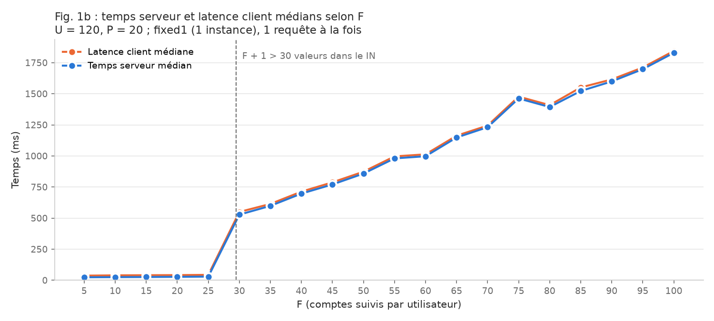

# PROJET-DONNEES-MASSIVES-ET-CLOUD
> TinyInsta passe-t-elle à l’échelle ? — Benchmark, édition 2026

<!--
Sections imposées du README : 
1. Montage (projet, région, versions, dates, d’où tourne le client).
2. Résultats des parties 1 à 3 (pour chacune : hypothèse, figures, interprétation).
3. Tableau des verdicts.
4. Validité.
5. Coût de la campagne.
-->

# Rapport

## 1. Montage
- Projet : tp1bigdata2026
- Région : europe-west1
- Tarif : eur3
- Versions :
    - Par défaut une instance en autoscaling nommée 20261121t111034, créée le 21/11 à 12h12m38s (2026-11-21T11:12:38+00:00)  
    > l'URL https://tp1bigdata2026.ew.r.appspot.com <!-- J'ai repris la base du projet TP1 -->
    - Une instance fixe (sans autoscaling) nommée fixed1, créée le 21/11 à 15h39m55s (2026-11-21T14:39:55+00:00)
    > l'URL : https://fixed1-dot-tp1bigdata2026.ew.r.appspot.com
- Client : Locust 2.47.0, lancé depuis Cloud Shell

## 2. Résultats
### Partie 1 — Coût d’une requête  

> Question : de quoi dépend le temps de traitement d’une timeline ?

- Analyse de la fonction `get_timeline` dans le main.py :
    - La fonction a pour but d'envoyer 20 posts des gens que l'utilisateur suit et les posts de l'utilisateur lui-même dans son fil d'actualité (timeline)
    - Elle est composée de 3 méthodes pour obtenir cette timeline :
        1. Première méthode : Utilise GQL si le SDK python est capable pour obtenir les 20 derniers posts des utilisateurs suivis par date de création, sinon appelle deuxième méthode. À noter qu'après un test effectué plus tard dans le développement, j'ai testé si la bibliothèque "google-cloud-datastore" possédait la méthode "gql" et le résultat est non. 
        Voir requête ci-dessous :
        ```
        victorfombertasse@cloudshell:~ (tp1bigdata2026)$ python3 -c "from google.cloud import datastore; print('gql ?', hasattr(datastore.Client(), 'gql'))" 
        gql ? False
        ```
        2. Deuxième méthode : Possède le même sens que la requête d'avant, mais construite avec des fonctions python. À noter que le paramètre 'IN' ne peut excéder 30 clauses d'égalité (==) sur la même propriété. [Utilisez l'opérateur `IN` pour combiner jusqu'à 30 clauses d'égalité (`==`) sur la même propriété avec un opérateur `OR` logique.](https://docs.cloud.google.com/datastore/docs/concepts/queries?hl=fr#in)
        3. Troisième méthode : Possède aussi le même sens que les requêtes d'avant. Cette méthode effectue manuellement les égalités en faisant une requête pour chacun des gens que l'on suit (peut devenir très coûteux si l'on suit beaucoup de gens).

- Hypothèse pour chaque attribut :
    - U : Qu'il y ait 1 ou énormément d'utilisateurs la requête s'effectue juste pour 1 utilisateur, donc le temps de traitement devrait être quasi constant.
    - P : Dû au limit 20 et avec l'index trié par date, on ne lit jamais plus de 20 posts par requête, donc le temps de traitement devrait être quasi constant.
    - F : La liste envoyée au 'IN' contient F+1 valeurs (les F gens suivis + l'utilisateur lui-même).
        - Si F+1 ≤ 30, soit F ≤ 29 : passe par la deuxième méthode donc n'utilise qu'une seule requête, donc temps de traitement quasi constant.
        - Si F+1 > 30, soit F ≥ 30 : la limite de 30 du 'IN' fait échouer la deuxième méthode, et ça bascule sur la troisième, qui fait F+1 requêtes les unes après les autres. Donc le temps de traitement sera sûrement linéaire en F.
        - On s'attend donc à voir un goulot d'étranglement à F = 30.
        

- Protocole :
    - Version fixed1 (1 instance fixe), 1 requête à la fois ("-u 1"), 45s par run, une run par jeu de données (26 runs : base, u100, u10000, p10/p100/p1000, f05 à f100). Les runs ont été lancés à la suite depuis Cloud Shell avec [`scripts/mesures_p1.sh`](scripts/mesures_p1.sh), les journaux bruts sont dans [`raw/`](raw/) (`p1_<jeu>.csv`). Les figures et leurs CSV sont générés par [`scripts/figures.py`](scripts/figures.py). Les 5 premières secondes de chaque run sont écartées (cold start) et 0 échec avec des HTTP 200.

- Analyse des figures :


On remarque sur cette image que les facteurs U et P ont quelques millisecondes (1-2ms) de différence sur des jeux de données de 1 à 10 à 100 fois plus grands. Cette différence de quelques ms est probablement une marge d'erreur liée au bruit. 



De F = 5 à F = 25 le graphique semble constant puis on remarque sur la figure un point de bascule entre F = 25 et F = 30 suivi d'une montée quasi linéaire.

- Vos hypothèses sont-elles confirmées ? Sinon, qu’aviez-vous manqué ?
    - U : Oui, l'écart d'environ 1-2ms est lié au bruit mais le temps est bien quasi constant avec le facteur U.
    - P : Oui, pareil pour l'écart d'environ 2ms, c'est lié au bruit. C'est quasi constant avec le facteur P grâce à l'index composite Post(author, created desc), qui trie les posts de chaque auteur par date et avec LIMIT 20 on ne lit jamais plus de 20 posts.
    - F : Oui en partie 
        - Pour F = 30 on a bien eu un goulot d'étranglement (F = 25 à F = 30) dû au "IN" du programme qui ne fonctionne plus après F+1 = 30, c'est passé d'environ 30ms à environ 500ms soit 17 fois plus.
        - De F = 5 à F = 25, on est passé de 23,9ms à 29,3ms : le temps n'est donc pas strictement constant, il y a une légère augmentation que je n'avais pas prévue (Datastore exécute probablement le "IN" comme F+1 sous-requêtes qu'il fusionne). Mais cette hausse de 5ms reste négligeable comparé à l'augmentation à partir de F = 30.
        - Après F = 30 la montée est bien linéaire : le temps passe de 527ms (F = 30) à 1829ms (F = 100), soit environ 19ms de plus par compte suivi. Le F = 75 (1462ms) est plus grand que le F = 80 (1393ms), je ne pense pas que ça invalide l'hypothèse sur la linéarité après F = 30 mais qu'il s'agit de bruit induit par le protocole du 45s par run, l'échantillon possède environ 900 requêtes sur les F faibles et environ 25 pour les F élevés.

- Quelle part de la latence client est due au réseau ?
    - L'écart avec la latence client et celle du serveur ne bouge pas beaucoup, environ 13,5ms (entre 12,5ms et 15,8ms) pour tous les jeux de données, ça ne dépend donc pas de U, P ou F.
    - Pour les timelines rapides F ≤ 25, environ 30 à 35% du temps se passe hors de `get_timeline`, ce qui inclut le réseau, tandis que pour les grosses timelines F = 100, ça représente moins d'1% du temps. Le réseau pèse donc beaucoup sur les petites requêtes, mais presque rien sur les grosses.


- Combien d’entités Datastore une timeline lit-elle, selon U, P et F ? Déduisez-en le coût de 1 million de timelines dans chaque cas (grille tarifaire de Datastore) :

aeiouy des milliards de millions de feur


### Partie 2
### Partie 3

## 3. Verdicts

## 4. Validité 

## 5. Coût de la campagne 